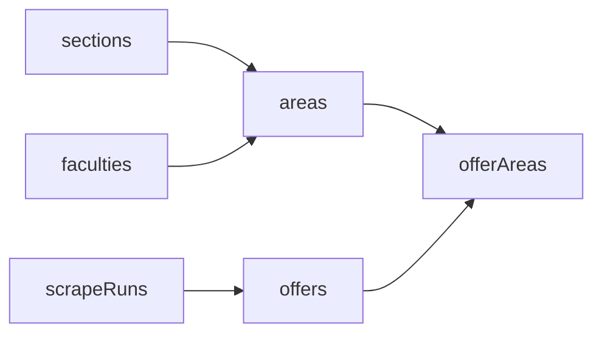
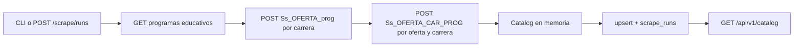

# Arquitectura

pp-backend es la API que consume pp-app. Hoy entrega el catálogo de programas de servicio social y práctica profesional del SIIAA. El mismo servicio va a crecer con más endpoints, llamadas a Gemini y almacenamiento en Cloudflare R2, sin partirse en varios deployables.

## Alcance

- Servir el catálogo en el contrato que pp-app ya espera (`Catalog` en `pp-app/lib/data/types.ts`).
- Bajar ese catálogo del SIIAA con HTTP, sin navegador, y guardarlo en PostgreSQL.
- Dejar el lugar y las reglas para migraciones, Gemini y R2.

pp-app sigue siendo una aplicación Next.js aparte. Este backend no renderiza el front: le responde JSON y le abre CORS.

## Principios

- **Monolito modular.** Un proceso, un deploy. Cada dominio vive en `app/modules/<dominio>` con sus modelos, esquemas y rutas. Un dominio no importa el router de otro.
- **Capas cortas.** El router valida y traduce HTTP. El servicio aplica el caso de uso. El repositorio habla con la base. El parser no conoce PostgreSQL.
- **Contratos tipados.** Lo que sale por la API es un modelo Pydantic. El JSON usa camelCase para coincidir con el front.
- **I/O asíncrono.** SQLModel `AsyncSession` sobre SQLAlchemy asyncio con asyncpg, y httpx para el SIIAA. Los repositorios usan `session.exec()` de SQLModel; el sessionmaker y las dependencias deben usar esa misma clase.
- **Configuración por entorno.** Nada de secretos en el código. `pydantic-settings` lee `.env`.
- **Scraping idempotente y cuidadoso.** La oferta se identifica por folio y la carrera por nivel + nombre, con UUID v5. Repetir el scrape actualiza filas, no las duplica. La concurrencia y una pausa corta evitan tumbar el sitio de la BUAP.

## Stack

| Pieza | Para qué |
| --- | --- |
| Python 3.13 | Versión fijada en `.python-version`. |
| FastAPI 0.143 | API, generada con `fastapi-new` (la herramienta de la documentación oficial) y `uv`. |
| uv | Entorno, lockfile e instalación. |
| Pydantic v2 + pydantic-settings | Esquemas y configuración. |
| SQLModel + SQLAlchemy asyncio + asyncpg | Modelos y acceso a PostgreSQL. |
| Alembic | Migraciones. |
| PostgreSQL 17 | Base, en Docker para desarrollo. |
| httpx + tenacity | Cliente HTTP del SIIAA, con reintentos. |
| selectolax (lexbor) | HTML mal formado del PL/SQL Web Toolkit. El backend Modest de selectolax está deprecado. |
| Typer | Comando `python -m app.modules.scraper.cli`. |
| pytest, pytest-asyncio, respx | Tests, incluidos los del cliente HTTP. |
| ruff, mypy | Estilo y tipos. |

## Estructura

```
app/
  main.py                 aplicación, CORS, lifespan
  core/                   config, engine, auth del admin, logging
  api/v1/                 reúne los routers
  modules/catalog/        lectura del catálogo y tablas
  modules/scraper/        cliente, parsers, normalización, job y CLI
  integrations/           reservado para Gemini y R2
alembic/                  migraciones
scripts/prestart.sh       alembic upgrade head antes de arrancar
docs/ARCHITECTURE.md
```

`integrations/` no tiene clientes todavía. Cuando entren, Gemini va en `integrations/gemini` (SDK `google-genai`) y R2 en `integrations/r2` (cliente S3 apuntando al endpoint de Cloudflare). Ninguno de los dos se importa desde un parser.

## Datos



- `sections`: Ingenierías, Licenciaturas, Área de la salud, Economía y administración. El id de la última es `economia`, el mismo que usa pp-app.
- `faculties`: salen del detalle. Si reconocemos la facultad, guardamos el id corto (`fcc`, `fcfm`, `fiq`, …) y el nombre largo.
- `areas`: una carrera. `Lic. / Ing.` produce dos filas y no duplica la oferta.
- `offers`: un programa, una vez, identificado por folio. Los bloques del detalle (listado, resumen, general, supervisor, nombramiento, programa) son columnas. `social_axes` es `text[]`.
- `offer_areas`: actividades y competencias de esa oferta para esa carrera. De aquí salen `areaDetails` y `offerIds`.
- `scrape_runs`: cada ejecución, con estados `running`, `succeeded` y `failed`, estadísticas y error. La CLI crea el run antes de descargar. El catálogo y el estado exitoso se confirman en una misma transacción; ante fallos se revierte el catálogo y se registra `failed` en una sesión nueva. Lo que ya no aparece en un scrape completo se marca `is_active = false`; el catálogo solo devuelve filas activas.

## Flujo del scrape



El sitio pagina con DataTables en el navegador. El HTML ya trae todas las carreras y todas las filas, así que no se recorren páginas. Los formularios van en ISO-8859-1 y el marcado no cierra bien las celdas: por eso el parser es lexbor y busca etiquetas ("No. de programa:", "Fecha de registro:"), no posiciones frágiles.

Un error de listado o detalle después de los reintentos impide publicar el scrape completo: se conserva el catálogo anterior. Los parsers rechazan páginas sin la estructura esperada; un listado con encabezados válidos y cero ofertas sí se acepta. Los detalles deben contener tipo, número de programa y nombre. El dry run puede guardar resultados parciales para diagnóstico, con estadísticas en la salida y código de salida 1.

`--limit-careers` solo se permite con `--dry-run`, para evitar desactivar ofertas fuera del límite. `--out` también es exclusivo del dry run. El dry run no crea un `scrape_run` ni usa conexiones a la base.

La pestaña que se baja es Programas educativos. Una oferta que aplica a Licenciatura e Ingeniería se guarda una vez y se enlaza a las dos áreas. El texto de actividades puede ser distinto en cada una, porque cada detalle se pide con su propio `ca`.

## API

Prefijo `/api/v1`. También existe `GET /health` en la raíz para el probe.

| Método | Ruta | Quién |
| --- | --- | --- |
| GET | `/health`, `/api/v1/health` | público |
| GET | `/api/v1/catalog` | público, contrato `Catalog` |
| GET | `/api/v1/areas/{slug}` | público, carrera y sus ofertas |
| GET | `/api/v1/offers/{uuid}` | público |
| POST | `/api/v1/scrape/runs` | `X-Admin-Key`, responde 202 |
| GET | `/api/v1/scrape/runs/{id}` | `X-Admin-Key` |

Convenciones:

- camelCase en el JSON (`scrapedAt`, `offerIds`, `areaDetails`), vía `alias_generator`.
- Un scrape a la vez por proceso. El segundo recibe 409. La admisión está serializada y las tareas tienen referencias hasta que terminan. El apagado cancela las tareas y espera que registren su fallo antes de cerrar el engine.
- Desplegar un solo worker y una sola instancia. El lock es local al proceso; la CLI se ejecuta fuera de un scrape de la API. Un lock distribuido queda para cuando haya varios procesos.
- Error de FastAPI: `{"detail": "..."}`. 401 si falta o no coincide la llave. 404 si no está el recurso.
- CORS sale de `CORS_ORIGINS`. En local, `http://localhost:3000`.

`meta.scrapedAt` es la hora del último run exitoso. `meta.schemaVersion` hoy es `1`. `meta.source` es la URL pública del SIIAA.

## Migraciones

Alembic con engine async. `target_metadata` es `SQLModel.metadata`, con `naming_convention` para que los constraints tengan nombre estable.

Flujo:

1. Cambiar el modelo en `app/modules/.../models.py`.
2. `uv run alembic revision --autogenerate -m "que cambia"`.
3. Leer la migración. Autogenerate no es confiable con renombres, datos ni `downgrade`.
4. `uv run alembic upgrade head`.

Reglas:

- Toda migración tiene `downgrade`.
- No se edita una migración ya aplicada en algún entorno. Se agrega otra.
- El cambio de datos va en una migración distinta a la del esquema.
- Un cambio destructivo se hace en dos pasos: primero se agrega lo nuevo y se escribe en los dos lados; en un deploy posterior se quita lo viejo.
- `scripts/prestart.sh` corre `alembic upgrade head` antes de uvicorn. El contenedor entra por `scripts/start.sh`, que llama a ese script.

La revisión `0001_create_catalog` crea `sections`, `faculties`, `areas`, `offers`, `offer_areas` y `scrape_runs`.

## Configuración

`.env.example` lista las variables. Las que importan:

| Variable | Uso |
| --- | --- |
| `POSTGRES_USER`, `POSTGRES_PASSWORD`, `POSTGRES_DB` | Variables obligatorias de Compose para inicializar PostgreSQL |
| `COMPOSE_DATABASE_URL` | URL obligatoria con host `db`; Compose la entrega a la API como `DATABASE_URL` |
| `DATABASE_URL` | URL para ejecutar el backend fuera de Docker, con host `localhost` |
| `CORS_ORIGINS` | JSON, por ejemplo `["http://localhost:3000"]` |
| `ADMIN_API_KEY` | Header `X-Admin-Key` del scrape |
| `SIIAA_BASE_URL` | Origen de los POST |
| `SCRAPE_CONCURRENCY` | Tope de requests simultáneos. Default 4 |
| `SCRAPE_DELAY_SECONDS` | Pausa antes de cada request |
| `SCRAPE_TIMEOUT_SECONDS` | El sitio responde lento |
| `LOG_LEVEL` | Logging estándar |

Compose obtiene las credenciales de `.env`, sin valores por defecto en el YAML. Las URLs deben coincidir con el usuario, contraseña y base configurados; los caracteres especiales del usuario o contraseña se codifican para URL. El healthcheck usa las variables del contenedor PostgreSQL. Cambiar `.env` no cambia las credenciales de un volumen ya inicializado.

## Tests

`tests/fixtures/` guarda HTML real del SIIAA (carreras, listado de Actuaría y un detalle). Los tests de parsers y de normalización no tocan la red. El del cliente usa respx. El de `/catalog` compara la forma con `tests/fixtures/catalog.json`, un extracto representativo del ejemplo de pp-app, sin depender de rutas externas. Se comparan las llaves del contrato, no los folios actuales del sitio.

Los tests de jobs cubren publicación completa, fallos, estadísticas, cancelación y admisión concurrente. Los de CLI cubren el subcomando `run`, opciones inválidas y exportación parcial. Ruff y Mypy forman parte de la verificación.

`tests/test_postgres_integration.py` usa `TEST_DATABASE_URL` apuntando a una base desechable cuyo nombre empiece con `pp_backend_test`. Verifica upgrade/downgrade, ausencia de drift con `alembic check`, upserts repetidos, desactivación, rollback y rutas con PostgreSQL. El fixture borra el esquema al terminar; nunca se ejecuta contra una base de la aplicación.

## Ejecución local

```bash
cp .env.example .env
docker compose up -d db
uv run alembic upgrade head
uv run fastapi dev
```

`docker compose up` también puede construir la API. Ahí el contenedor migra solo, vía `scripts/start.sh`, y Compose asigna `COMPOSE_DATABASE_URL` de `.env` a `DATABASE_URL` para usar el host `db`. El arranque local fuera de Docker usa `DATABASE_URL` con `localhost`.

El scrape completo son decenas de carreras y, por carrera, cientos de detalles. Se dispara a propósito, por CLI o por el endpoint admin. No hay cron todavía.

## Qué sigue

- **Job programado.** Un proceso aparte (arq o APScheduler) que llame al mismo `ScraperService`. No vive dentro del request.
- **Gemini.** `app/integrations/gemini` con `google-genai`. Los módulos le piden una función, no arman el SDK en el router.
- **Cloudflare R2.** `app/integrations/r2` con cliente S3 (`endpoint_url` de R2). Sirve para archivos que el front no debe pedir directo al SIIAA.
- **Auth de usuarios.** Hoy solo existe la llave admin del scrape. La de usuarios entra cuando haya cuentas, sin mezclarla con `X-Admin-Key`.

## Estado de verificación (2026-10-10)

- Tests sin red, Ruff y Mypy: verificados.
- SQL de la migración inicial: upgrade y downgrade ejecutados en PostgreSQL 16 en modo single-user, sobre un cluster temporal. Esto valida el DDL, pero no sustituye la integración con asyncpg ni la ejecución en PostgreSQL 17.
- Integración con PostgreSQL/asyncpg y Docker: pendiente en un entorno con sockets habilitados. Aquí Docker no está disponible y el sandbox rechaza sockets TCP y Unix.
- Scrape real completo y comparación del contrato e integridad de referencias con pp-app: pendiente. Aquí no se resuelve el host SIIAA. La comparación debe permitir cambios en folios y cantidades, conservando UUIDs deterministas, campos camelCase y referencias válidas.
