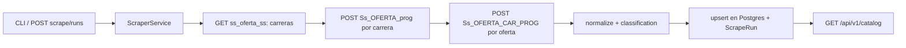

# Backend FastAPI + scraper SIIAA

## Hallazgos del sitio (verificados con curl)

El sitio es Oracle PL/SQL Web Toolkit, en ISO-8859-1. No necesita navegador headless: todo se puede hacer con `httpx`.

- `SS_ALUM_AUTSV_OFERTA_C` mete en un iframe a `SS_OFERTA`, que tiene las pestañas. La pestaña "Programas educativos" es un GET a `ss_oferta_ss?se=ABE63459925DAD50`.
- Esa página trae todas las carreras (alrededor de 60) en el HTML. La paginación es de DataTables y ocurre en el cliente, así que no hay que recorrer páginas. Cada carrera es un form `POST Ss_OFERTA_prog` con `un` y `se`.
- El POST de una carrera regresa la tabla de ofertas: Folio, Programa, Tipo, Área, Perfil educativo, Coordinador, Curso Inducción, Empresa. "Perfil educativo" es un form `POST Ss_OFERTA_CAR_PROG` con `v_01` y `ca`.
- El POST del detalle regresa summary, general, supervisor, appointment, programInfo, actividades y competencias por carrera, y una tabla final con Facultad, Perfil educativo y Campus. De ahí sale `faculties`.
- El HTML está mal formado (celdas sin cerrar, `</form>` sueltos). Para parsear uso `selectolax` (lexbor), que es tolerante, y extraigo los datos por etiqueta de texto ("No. de programa:", etc.), no por posición.

## Decisiones

- PostgreSQL 17 en Docker, SQLModel (async con asyncpg) y migraciones con Alembic.
- La API la consume pp-app con CORS. El backend será un monolito modular que después también va a integrar Gemini y Cloudflare R2.
- El scrape se dispara por CLI o por un endpoint admin protegido. Por ahora no hay job programado; solo queda documentado.

## Creación del proyecto

- Ejecutar `uvx fastapi-new` (el creador oficial de la doc de FastAPI). Si no admite generar en el directorio actual, usar `uv init` + `uv add "fastapi[standard]"`.
- FastAPI 0.143, Python 3.13 fijado en `.python-version`.
- Dependencias: `fastapi[standard]`, `sqlmodel`, `asyncpg`, `alembic`, `pydantic-settings`, `httpx`, `selectolax`, `tenacity`, `typer`.
- Dependencias de desarrollo: `pytest`, `pytest-asyncio`, `respx`, `ruff`, `mypy`.

## Estructura

```
pp-backend/
  pyproject.toml  uv.lock  .python-version  .env.example
  docker-compose.yml        # postgres + api
  Dockerfile  scripts/prestart.sh   # alembic upgrade head
  alembic.ini  alembic/{env.py, versions/}
  docs/ARCHITECTURE.md
  app/
    main.py                 # create_app, lifespan, CORS, routers
    core/{config.py, db.py, security.py, logging.py}
    api/{deps.py, v1/router.py}
    modules/
      catalog/{models.py, schemas.py, repository.py, service.py, router.py}
      scraper/{client.py, parsers/{careers.py, listing.py, detail.py},
               normalize.py, classification.py, service.py, models.py,
               router.py, cli.py}
    integrations/           # reservado para gemini/ y r2/ (solo documentado)
  tests/{fixtures/*.html, test_parsers.py, test_normalize.py, test_catalog_api.py}
```

## Flujo del scraper




- `**client.py**`: `httpx.AsyncClient` que decodifica latin-1, con timeout alto (el sitio es lento), reintentos con `tenacity`, un semáforo de concurrencia (alrededor de 4) y un pequeño throttle para no saturar el servidor.
- **Deduplicación**: una oferta se guarda una vez por `folio`, aunque aparezca en varias carreras. Cada carrera en la que aparece agrega un `areaDetails` y su `offerId` al área.
- `**normalize.py**`:
  - Tipo a `servicio_social` o `practica_profesional`.
  - Fechas `DD/MM/YY` a ISO, conservando el valor `*Raw`.
  - "3 Meses" a `3`; "si"/"no" a booleano; "1 , 2027" a "1, 2027".
  - Separar `Lic.` / `Ing.` en `level` y `name`. "Lic. / Ing." genera dos áreas.
  - Generar `slug`.
  - UUIDs deterministas con `uuid5`: el área por `level + nombre normalizado`, la oferta por `folio`. Así los ids no cambian entre scrapes.
- `**classification.py**`: mapeo declarativo de carrera a sección (`ingenierias`, `licenciaturas`, `salud`, `economia-administracion`, con su `order`) y de nombre de facultad a id corto (ej. `fcc`). Si una carrera no está mapeada, se usa un fallback por nivel y se registra un warning.
- **Carreras sin ofertas**: no traen nivel en la lista. Se crean solo si `classification.py` define su nivel; si no, se omiten y se registran en el log.
- **Persistencia**: el upsert es idempotente. Las ofertas que ya no aparecen se marcan `is_active=false`. El catálogo solo devuelve ofertas activas, y `meta.scrapedAt` sale del último `ScrapeRun` exitoso.

## Modelo de datos (Postgres)

- `sections(id, name, order)`
- `faculties(id, name)`
- `areas(uuid, slug unique, name, raw_name, level, section_id fk, faculty_id fk)`
- `offers(uuid, folio unique, ...)`: columnas tipadas para listing, summary, general, supervisor, appointment y program_info; `social_axes` como `ARRAY(text)`; además `is_active` y `last_seen_run_id`.
- `offer_areas(offer_uuid, area_uuid, activities, competencies)`: es la relación muchos a muchos. De aquí salen `areaDetails` y `offerIds`.
- `scrape_runs(id, status, started_at, finished_at, stats jsonb, error)`

## API (`/api/v1`, JSON en camelCase vía `alias_generator`)

- `GET /health`
- `GET /catalog`: devuelve exactamente el tipo `Catalog` de [pp-app/lib/data/types.ts](/home/alanvalerdi/Developer/pp-app/lib/data/types.ts).
- `GET /areas/{slug}` y `GET /offers/{uuid}`
- `POST /scrape/runs`: requiere el header `X-Admin-Key`. Responde 202 con el id del run y ejecuta el scrape en una tarea asyncio con un lock, para que no corran dos a la vez.
- `GET /scrape/runs/{id}`: estado del run.
- CLI:
  - `uv run python -m app.modules.scraper.cli run` guarda en la BD.
  - Con `--dry-run --out data/siiaa-offers.json` solo genera el archivo JSON, sin tocar la BD, para comparar con pp-app.

## Migraciones (política en el doc)

- Alembic con plantilla async. `target_metadata = SQLModel.metadata`, con `naming_convention` para constraints.
- Flujo de trabajo:
  1. Cambiar el modelo.
  2. `alembic revision --autogenerate -m "..."`.
  3. Revisar a mano la migración generada.
  4. `alembic upgrade head`.
- Reglas:
  - Cada migración tiene su `downgrade`.
  - Nunca se edita una migración ya aplicada.
  - Las migraciones de datos van separadas de las de esquema.
  - Los cambios destructivos se hacen en dos pasos (expand/contract).
- En deploy, `scripts/prestart.sh` corre `alembic upgrade head` antes de arrancar uvicorn.
- La primera migración crea todas las tablas.

## docs/ARCHITECTURE.md

Secciones:

- Propósito y alcance.
- Principios: monolito modular por dominio; capas router, service, repository; contratos tipados con Pydantic; I/O async; configuración 12-factor; scraping idempotente y respetuoso con el sitio.
- Stack y librerías, con el porqué de cada una.
- Estructura de carpetas.
- Diagramas de datos y de flujo.
- Convenciones de la API: versionado, camelCase, formato de errores, CORS.
- Migraciones.
- Configuración y variables `.env`.
- Testing con fixtures HTML reales.
- Ejecución local con docker compose.
- Roadmap:
  - Job programado (APScheduler o arq).
  - `integrations/gemini` con `google-genai`.
  - `integrations/r2`: Cloudflare R2 con cliente S3-compatible.
  - Auth.

## Verificación

- Tests de parsers sobre HTML real guardado en `tests/fixtures` (carreras, listado y detalle).
- Tests de normalización: caso "Lic. / Ing.", fechas y booleanos.
- Test del endpoint `/catalog` contra la forma de `Catalog`.
- Correr un scrape real con `--dry-run` y comparar la salida con [pp-app/data/siiaa-offers.json](/home/alanvalerdi/Developer/pp-app/data/siiaa-offers.json).


## Reanudación y estado (2026-10-10)

Implementados: sesiones async de SQLModel coherentes con `exec`, typing sin errores, publicación atómica solo de scrapes completos, run de CLI antes de descargar, límites solo en dry run, subcomando `run`, rechazo de páginas inesperadas, tareas registradas con cancelación al apagar, host `db` en Compose y fixtures de contrato locales.

Los runs incompletos conservan el catálogo previo y registran estadísticas/error. Un dry run parcial exporta para diagnóstico y devuelve código 1. El lock de API es por proceso; usar un solo worker/instancia y no persistir desde CLI mientras corre la API.

Verificados: tests sin red, Ruff, Mypy y DDL de upgrade/downgrade en PostgreSQL 16 single-user. Las pruebas PostgreSQL/asyncpg están implementadas como integración opt-in con `TEST_DATABASE_URL` y siguen pendientes de ejecución. Docker no está disponible; el sandbox rechaza sockets TCP/Unix y no resuelve SIIAA. La prueba en PostgreSQL 17, el arranque Compose y el scrape real completo con comparación contra pp-app siguen pendientes. No marcar el paso tests como terminado hasta completar estas verificaciones.
